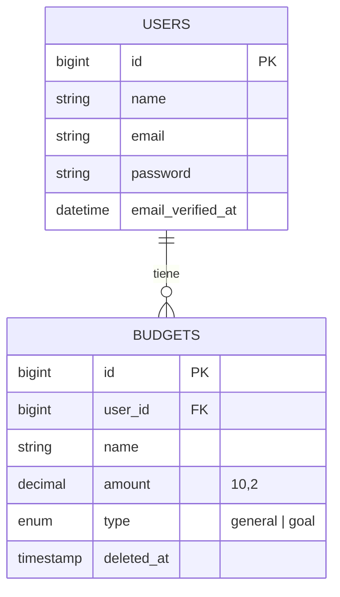
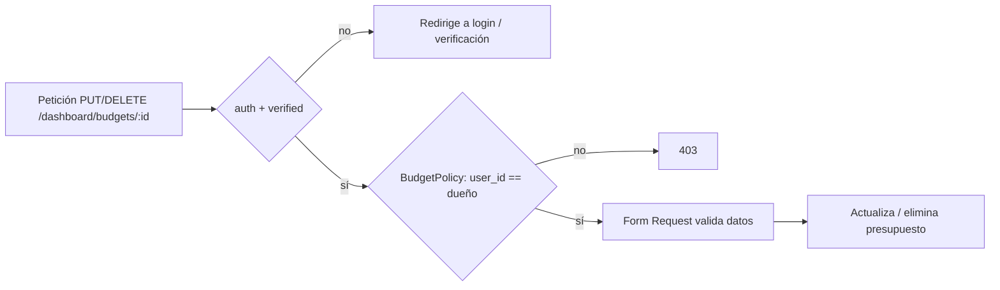

<p align="center"><a href="https://laravel.com" target="_blank"></a></p>

# CashTrackr

Aplicación web para administrar presupuestos personales (generales o metas de ahorro), construida con **Laravel 13** y **PHP 8.3**. Cada usuario solo puede ver y modificar sus propios presupuestos.

## Funcionalidades

- Registro, inicio de sesión y cierre de sesión.
- Verificación de correo electrónico (enlace firmado con límite de intentos).
- CRUD de presupuestos con tipo `general` o `goal` (meta).
- Autorización por dueño: solo el creador puede editar o eliminar un presupuesto (Policy).
- Eliminación lógica (*soft delete*) de presupuestos.
- Páginas de error 403 y 404 personalizadas.

## Stack

| Capa | Tecnología |
|---|---|
| Backend | PHP 8.3, Laravel 13 |
| Frontend | Blade, Tailwind CSS 4, Vite |
| Base de datos | MySQL (Eloquent + migraciones) |
| Pruebas | Pest 5 + pest-plugin-laravel |

## Decisiones de diseño

- **Policies con atributos** (`#[Authorize('update','budget')]`) en `BudgetController`: la regla de propiedad vive en `BudgetPolicy`, no repetida en cada método.
- **Form Requests** (`BudgetRequest`, `SignInRequest`, `SignupRequest`): la validación se separa del controlador.
- **Enum `BudgetType`** como *cast* en el modelo: evita strings sueltos para el tipo.
- **SoftDeletes** en `budgets`: un borrado no destruye el dato.
- **Middleware `auth` + `verified`** en el grupo del dashboard: solo usuarios con correo verificado.

## Modelo de datos



## Flujo de autorización



## Instalación

```bash
git clone https://github.com/carlos-dev23/cashtrackr.git
cd cashtrackr
composer install
cp .env.example .env
php artisan key:generate
# configura DB_* en .env y luego:
php artisan migrate
npm install
npm run dev
php artisan serve
```

## Pruebas

```bash
php artisan test
```

Cubren el flujo de autenticación: pantalla de login, acceso con usuario verificado, credenciales inválidas, bloqueo a usuarios sin verificar y registro.

## Pendiente / siguientes pasos

- Pruebas de la Policy y del CRUD de presupuestos.
- Workflow de GitHub Actions para correr Pest en cada push.
